<div align="center">

<!-- [0x00] IMMERSIVE HERO: THE AUTONOMIC CHRONOGRAPH // SILA KERNEL -->
<picture>
  <source media="(prefers-color-scheme: dark)" srcset="./assets/hero-chronograph.svg">
  <source media="(prefers-color-scheme: light)" srcset="./assets/hero-chronograph.svg">
  
</picture>

<!-- [0x01] LIVE MEMORY-MAPPED TELEMETRY REGISTER -->
<picture>
  <source media="(prefers-color-scheme: dark)" srcset="./assets/telemetry-bar.svg">
  <source media="(prefers-color-scheme: light)" srcset="./assets/telemetry-bar.svg">
  
</picture>

</div>

<br/>

<!-- [0x02] ARCHITECTURAL THESIS -->
```text
SYS.MANIFEST // 0x08_ADAPTIVE_CONVERGENCE
──────────────────────────────────────────────────────────────────────────────────────────
Engineering deterministic firmware, low-level systems architectures, and adaptive physical
intelligence. Every subsystem is designed for bounded execution latency, zero-heap memory
safety, and autonomous disturbance rejection under fault conditions.
```

<div align="center">
  
</div>

### `0x08_A` // FLAGSHIP SYSTEMS & HARDWARE REGISTERS

<!-- DYNAMIC_PROJECTS_START -->
<table width="100%">
  <tr>
    <td width="33%" valign="top">
      <h4><code>[0x01]</code> <a href="https://github.com/hamsavartn/raptor"><strong>raptor</strong></a></h4>
      <p><sub><code>REG: 0x0800_0100</code> • <code>SHA: 4004EC0</code> • <code>2026-08-30</code></sub></p>
      <p>A zero-dependency Taskfile v3 task runner built with Go stdlib only. Hand-written YAML parser, DAG scheduler, cycle detection, incremental builds — no require block, no go.sum.</p>
      <p><code>Go</code> <code>Shell</code></p>
    </td>
    <td width="33%" valign="top">
      <h4><code>[0x02]</code> <a href="https://github.com/hamsavartn/JanusGate"><strong>JanusGate</strong></a></h4>
      <p><sub><code>REG: 0x0800_0200</code> • <code>SHA: 12266D7</code> • <code>2026-10-12</code></sub></p>
      <p>The AI agent firewall: One face watches what enters, one watches what leaves. Defends against prompt injections, exfiltration, and scams with a multi-layer ensemble.</p>
      <p><code>Python</code> <code>Dockerfile</code></p>
    </td>
    <td width="33%" valign="top">
      <h4><code>[0x03]</code> <a href="https://github.com/hamsavartn/rtos-edge-gateway"><strong>rtos-edge-gateway</strong></a></h4>
      <p><sub><code>REG: 0x0800_0300</code> • <code>SHA: 31998BA</code> • <code>2026-10-06</code></sub></p>
      <p>RTOS-Based Industrial Edge Gateway | STM32F103C8 + FreeRTOS</p>
      <p><code>C++</code> <code>C</code> <code>Python</code></p>
    </td>
  </tr>
</table>
<!-- DYNAMIC_PROJECTS_END -->

<div align="center">
  
</div>

### `0x08_B` // SILICON-TO-SYSTEMS SPECIFICATION MATRIX

| REGISTER OFFSET | DOMAIN LAYER | VERIFIED TOOLCHAIN & ARCHITECTURAL PRIMITIVES | CONVERGENCE MODE |
| :--- | :--- | :--- | :--- |
| **`0x0800_1000`** | **Bare-Metal & RTOS** | `C` `Embedded C++` `FreeRTOS (Static Allocation)` `ARM Cortex-M3/M4` `CMSIS-DSP` `STM32 HAL/LL` | `DETERMINISTIC // 0-HEAP` |
| **`0x0800_1040`** | **Buses & Peripherals** | `DMA Ring Buffers` `I2C` `SPI` `UART/USART` `ADC Multi-Channel` `Hardware Watchdog (IWDG)` | `HARD REAL-TIME` |
| **`0x0800_1080`** | **Adaptive & Edge Intelligence** | `Residual Fault-Belief Inference` `Adaptive Control Loops` `PyTorch` `Physics-Informed Surrogates` | `CLOSED-LOOP ADAPTIVE` |
| **`0x0800_10C0`** | **Verification & Tooling** | `PlatformIO` `CMake` `GCC Arm Embedded` `Wokwi Hardware Simulation` `Git / GitHub Actions` | `CONTINUOUS VERIFICATION` |

<div align="center">
  
</div>

<div align="center">
  <sub><code>SYS.ID: HAMSAVARTN // KERNEL: DIVERGENT-SILA-08 // 45° STEPPING TELEMETRY ACTIVE</code></sub>
</div>
